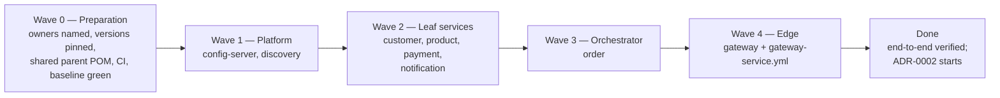

# ADR-0001: Upgrade all e-commerce services from Spring Boot 3.3.2 to 3.5 as the first step towards Spring Boot 4

| | |
|---|---|
| **Status** | Proposed |
| **Date** | 9 Nov 2026 |
| **Repository** | `github.com/CkanthG/e-commerce-micro-services` (`master`, last commit 15 Sep 2024) |
| **Scope** | All 8 services: config-server, discovery, gateway, customer, product, order, payment, notification |
| **Deciders** | One owner per service *(names to be filled in, see §9)* |


## 1. Summary

All eight services run **Spring Boot 3.3.2** with **Spring Cloud 2023.0.3** on Java 21. Boot 3.3 has been without open-source patches since **30 June 2025**, so these services have received no free security fixes from the Spring line for more than a year.

This ADR proposes to upgrade **all services together** to the **latest Spring Boot 3.5.x** patch with **Spring Cloud 2025.0.x**, keeping Java 21. The upgrade runs in coordinated waves, with one owner per service.

**Important:** Boot 3.5 itself is also past its open-source support end (**30 June 2026**), and so is Spring Cloud 2025.0.x. Version 3.5 is therefore **not a destination**. It's the step Spring officially requires before moving to Boot 4. This ADR covers phase 1 only. Phase 2 (Boot 4.x + Spring Cloud 2025.1.x) gets its own ADR and must start right after phase 1 ends (§4, §11).

---

## 2. Context

### 2.1 Current state

| Service | Role | Spring Boot | Spring Cloud | Java | Key Spring dependencies | Data / messaging |
|---|---|---|---|---|---|---|
| config-server | Central config (native profile, files in classpath) | 3.3.2 | 2023.0.3 | 21 | Config Server | — |
| discovery | Eureka server | 3.3.2 | 2023.0.3 | 21 | Eureka Server, Config client | — |
| gateway | API gateway, OAuth2 resource server (Keycloak) | 3.3.2 | 2023.0.3 | 21 | **Spring Cloud Gateway (WebFlux)**, Eureka, Security | — |
| customer | Customer CRUD | 3.3.2 | 2023.0.3 | 21 | Web, Data MongoDB | MongoDB |
| product | Products & categories | 3.3.2 | 2023.0.3 | 21 | Web, Data JPA, **Flyway** | PostgreSQL |
| order | Orders, order lines; calls customer/product/payment | 3.3.2 | 2023.0.3 | 21 | Web, Data JPA, **OpenFeign**, **Resilience4j**, Kafka producer | PostgreSQL, Kafka |
| payment | Payments | 3.3.2 | 2023.0.3 | 21 | Web, Data JPA, Resilience4j, Kafka producer | PostgreSQL, Kafka |
| notification | Emails on order/payment events | 3.3.2 | 2023.0.3 | 21 | Kafka consumer, Mail, Thymeleaf, Data MongoDB | MongoDB, Kafka |

All services use Micrometer Tracing with Brave → Zipkin, Actuator, and Lombok. Each service has its **own `pom.xml` with its own parent version**; there's no shared parent or BOM. Container images are built from `openjdk:21`, and Kubernetes manifests exist per service.

### 2.2 Why act now

- **No open-source patches.** Boot 3.3 open-source support ended on 30 June 2025. Spring Cloud 2023.0.x is tied to Boot 3.3; its last release (2023.0.6) is based on Boot 3.3.13. Even that is 11 patch releases ahead of the 3.3.2 used here.
- **The gap only grows.** Boot 4.0 (Nov 2025) and 4.1 are out. Spring's own migration guide requires being on the latest 3.5.x before going to 4.0. Skipping 3.5 doesn't save the work; it just piles up the risk.
- **Small, testable codebase.** 93 production Java files and 88 tests, with Testcontainers for PostgreSQL, Kafka and MongoDB. The upgrade can be verified, not just compiled.

### 2.3 Why this is a cross-team initiative

The services can't be upgraded independently without coordination, because they share:

1. **One config server.** All runtime configuration lives in `services/config-server/src/main/resources/configurations/*.yml`. Property renames (gateway, tracing) change a shared file that every team reads.
2. **One gateway.** Every public route (`/api/v1/customers`, `/products`, `/category`, `/orders`, `/order-lines`, `/payments`) goes through it. A gateway regression breaks all teams at once.
3. **One Spring Cloud release train.** Config, Eureka, Gateway, OpenFeign and Circuit Breaker versions come from the same BOM. Mixing trains for a long time is not a supported setup.
4. **Event contracts over Kafka.** order and payment produce JSON events that notification consumes, using Spring Kafka type mappings (`spring.json.type.mapping`). Producers and the consumer have to stay compatible during the rollout.
5. **No CI pipeline in the repository.** Nobody gets automatic feedback today, so the verification steps must be agreed and run by every team in the same way.

---

## 3. Decision

1. **Target versions for phase 1:**
    - Spring Boot: **latest 3.5.x patch available on Maven Central** at the start of the work. Spring Cloud 2025.0.3, the last open-source release of that train, is built on Boot 3.5.15.
    - Spring Cloud: **2025.0.3** ("Northfields").
    - Java: **21** (unchanged).
2. **One version for everyone.** Introduce a root `pom.xml` (aggregator + shared parent) that sets the Spring Boot and Spring Cloud versions once. Services inherit from it instead of each declaring `spring-boot-starter-parent` and `spring-cloud.version` separately. *(If owners prefer to keep fully separate builds, the fallback is a short "version contract" in the README that every PR is checked against.)*
3. **Upgrade in waves** (§6). Platform services first, then the business services, with the gateway's configuration change coordinated with the gateway upgrade.
4. **No feature work in upgrade PRs.** Only version bumps, the code and config changes needed for them (§5) and removal of dead config that blocks the upgrade. Pre-existing bugs found along the way are recorded (§5.4) and fixed in separate PRs.
5. **Phase 2 follows directly.** ADR-0002 (Boot 4.x + Spring Cloud 2025.1.x) is drafted while phase 1 runs and starts no later than **2 weeks after** phase 1 is done. Every deprecation warning found in phase 1 is fixed in phase 1, because Boot 4 removes all 3.x deprecations.

---

## 4. Options considered

| Option | Description | Pros | Cons | Verdict |
|---|---|---|---|---|
| **A. Stay on 3.3.2** | Do nothing | No effort now | No open-source fixes since mid-2025; the gap to Boot 4 keeps growing; dependency CVEs pile up | Rejected |
| **B. Upgrade to 3.5 and stop** | Phase 1 only | Moderate effort; latest 3.x APIs | 3.5 is also past open-source support (30 Jun 2026), so this only buys a better starting point, not a supported state | Rejected as an end state |
| **C. Upgrade to 3.5, then to 4.x** *(chosen)* | Phase 1 (this ADR) + phase 2 (ADR-0002) | Follows Spring's official path; each step is small enough to verify; deprecations are found while 3.5 still warns instead of failing | Two rounds of coordination; 3.5 is unsupported for the short time in between | **Accepted** |
| **D. Jump straight to 4.x** | One big migration | One coordination effort | Against Spring's guidance; mixes three years of changes (Hibernate 6.6 → 7, Jackson 3, modular starters, Spring Cloud Gateway renames, removed deprecations) in one step; hard to tell what broke what | Rejected |
| **E. Buy commercial 3.x support** | Paid extended support for the 3.5 line | Patches continue without migration work | Cost; only delays the migration; doesn't fit a project of this size | Fallback only if phase 2 is blocked |

---

## 5. Impact analysis

Each item below was found by reading this repository's code and configuration. "Owner" names the team that has to act.

### 5.1 Changes required for the upgrade

| # | Area | What changes | Where in this repo | Owner | Effort |
|---|---|---|---|---|---|
| I-1 | **Spring Cloud Gateway renames** (Spring Cloud 2025.0) | The starter `spring-cloud-starter-gateway` is deprecated in favour of `spring-cloud-starter-gateway-server-webflux`. Properties move from `spring.cloud.gateway.*` to `spring.cloud.gateway.server.webflux.*`. The old names still work but log deprecation warnings, and they will be removed later | `services/gateway/pom.xml`; `config-server/.../configurations/gateway-service.yml` (routes, discovery locator) | Gateway + config-server | S |
| I-2 | **Gateway: forwarded headers off by default** (Spring Cloud 2025.0) | `X-Forwarded-*` / `Forwarded` handling is disabled unless `spring.cloud.gateway.server.webflux.trusted-proxies` is set | `gateway-service.yml` | Gateway | S (decide whether it's needed) |
| I-3 | **Hibernate 6.6** (comes with Boot 3.4) | Calling `save()` on an entity whose `@GeneratedValue` id is already set now makes Hibernate merge it. If no row exists, Hibernate throws `OptimisticLockException` instead of inserting a new row | Mappers copy the client-supplied id into new entities: `order/.../OrderMapper.java` (`.id(request.id())`), `OrderLineMapper.java`, `payment/.../PaymentMapper.java`, `product/.../ProductMapper.java`, `CategoryMapper.java`. `OrderRequest` has an `Integer id` field | Order, payment, product | M |
| I-4 | **Remove items deprecated in Boot 3.3** (removed in 3.5) | Code or properties deprecated in 3.3 fail to compile or are ignored in 3.5 | All services. Find with `-Dmaven.compiler.showDeprecation=true` and `spring-boot-properties-migrator` | All | S |
| I-5 | **Dead tracing configuration** | `spring.zipkin.base-url` / `spring.zipkin.enabled` are Spring Cloud Sleuth properties, which Boot 3 ignores. Traces currently go to Boot's default endpoint (`localhost:9411`), which is wrong inside containers. Replace with `management.zipkin.tracing.endpoint` (and note that Boot 4 renames this again) | `application.yml` of customer, gateway, notification, order, payment, product | All | S |
| I-6 | **Test dependency drift** | `customer` pins `org.testcontainers:mongodb:1.20.0` while Boot manages the other Testcontainers modules. `customer` and `product` add `junit:junit:4.13.2`. Six controller tests carry a leftover `@RunWith(SpringRunner.class)` (they use JUnit 5 `@Test`, so the annotation does nothing) | `customer/pom.xml`, `product/pom.xml`, `*ControllerTest.java` | Customer, product, order, payment | S |
| I-7 | **Graceful shutdown by default** (Boot 3.4) | Embedded servers now wait for in-flight requests on shutdown (`server.shutdown=graceful`). This is usually desired; the manifests don't set `terminationGracePeriodSeconds`, so Kubernetes' 30 s default equals Boot's 30 s shutdown timeout, leaving no margin. Set it to e.g. 45 s | `services/*/k8s/*.yaml` | Platform | S |
| I-8 | **Actuator endpoint access model** (Boot 3.4) | `management.endpoint.<id>.enabled` / `management.endpoints.enabled-by-default` are replaced by `...access`. The heapdump endpoint defaults to no access in 3.5 | Not used today. Rule for new config: use `access` | All | — |
| I-9 | **Kafka JSON (de)serializers** | `JsonSerializer` / `JsonDeserializer` keep working in Spring Kafka 3.3 (Boot 3.5). They're deprecated in Spring Kafka 4 (Boot 4); record this for ADR-0002 | `order-service.yml`, `payment-service.yml`, `notification-service.yml` | Order, payment, notification | — (phase 2) |
| I-10 | **Library versions without Boot management** | Check what `resilience4j-spring-boot3` and the Feign/Eureka modules resolve to after the bump (`mvn dependency:tree`). They come from the Spring Cloud BOM, not from Boot | `order/pom.xml`, `payment/pom.xml` | Order, payment | S |
| I-11 | **Flyway** | Boot 3.5 manages a newer Flyway. `product` already declares `flyway-database-postgresql`, which newer Flyway versions require. Verify that V1/V2 migrations still validate against an existing database | `product` | Product | S |

Effort: S = under half a day, M = 1–2 days, per service.

### 5.2 Items checked and not affected

- **`taskExecutor` bean alias removed in Boot 3.5.** No code refers to an executor by name.
- **`@MockBean` / `@SpyBean` deprecation (Boot 3.4).** Not used.
- **`RestClient` / `RestTemplate` HTTP-client auto-detection (Boot 3.4).** Production code uses OpenFeign; `TestRestTemplate` is only used in tests.
- **Java baseline.** Boot 3.5 needs Java 17+; Java 21 stays.

### 5.3 Infrastructure (not part of the version bump, but affects verification)

- `docker-compose.yml` uses `:latest` for Postgres, MongoDB, Kafka and ZooKeeper. Pin versions before the upgrade so a "broken upgrade" isn't really a changed database image.
- Images are built on `openjdk:21`. The Docker Hub `openjdk` images are no longer maintained *(verify)*; switching to e.g. `eclipse-temurin:21-jre` is a separate, low-risk PR.
- order and payment use `spring.jpa.hibernate.ddl-auto: update`. A newer Hibernate may emit different schema changes. **Take a database snapshot before deploying** the upgraded order and payment services.

### 5.4 Pre-existing issues found during the analysis (separate PRs, not blockers)

| Found in | Issue |
|---|---|
| gateway `SecurityConfig` | `pathMatchers("(/eureka/**")` contains a stray `(`, so the intended permit rule never matches |
| notification `EmailService` | `@Async` is used, but `@EnableAsync` is only imported in `NotificationApplication`, never applied. So emails are sent synchronously on the Kafka listener thread |
| notification config | `spring.json.trusted.packages: '*'` trusts every class for deserialization |
| payment config | `spring.json.type.mapping` maps `paymentConfirmation` to `PaymentNotificationRequest`, while notification maps it to `PaymentConfirmation`. This works only because the field shapes match; worth an explicit contract |
| docker-compose | Default credentials (`sreekanth`/`sreekanth`, `admin`/`admin`, `root`/`example`) committed in plain text |

---

## 6. Rollout plan

### 6.1 Waves



| Wave | Services | Why this order | Exit criteria |
|---|---|---|---|
| **0 — Preparation** | all | Make the upgrade measurable before changing it | Owners named (§9); infra images pinned (§5.3); root parent POM with versions on 3.3.2 (no behaviour change); a GitHub Actions workflow runs `mvn -B verify` for all services; current build and tests green; end-to-end smoke test (§7.2) written down and passing on 3.3.2 |
| **1 — Platform** | config-server, discovery | Smallest code; everyone depends on them, so problems show up early. Config Server and Eureka speak HTTP/JSON, which older clients still understand | Both start; all 3.3.2 services still fetch config and register in Eureka |
| **2 — Leaf services** | customer, product, payment, notification | Don't call other services synchronously; can be done in parallel by their teams | Each service: build green, I-3/I-5/I-6/I-11 done where applicable, service registers and serves through the old gateway |
| **3 — Orchestrator** | order | Calls customer, product and payment through Feign + gateway, and produces Kafka events, so it goes after its dependencies | Order flow works end to end; the notification email arrives |
| **4 — Edge** | gateway + `gateway-service.yml` | Highest blast radius. The property prefix change (I-1) must ship **in the same release** as the gateway upgrade: the old gateway doesn't understand the new prefix | All routes answer through the gateway with a valid Keycloak token; no deprecation warnings in the gateway log |

**Mixed-version period.** Between waves, services on 3.3.2 and 3.5 run side by side. That's expected and fine for HTTP, Eureka and Kafka JSON, but it's verified explicitly at the end of every wave with the smoke test. The mixed period should not last longer than the planned schedule (§6.3).

### 6.2 Per-service procedure (same for every team)

1. Branch `upgrade/boot-3.5/<service>` from `master`.
2. Bump the version (via the root parent once it exists). Add `spring-boot-properties-migrator` as a **temporary** runtime dependency.
3. `mvn -B clean verify -Dmaven.compiler.showDeprecation=true`. Fix every compile error **and** every deprecation warning.
4. Start the service against the shared docker-compose stack. Read the properties-migrator report in the log and fix every reported property. Then remove the migrator.
5. Apply the service-specific items from §5.1.
6. Run the smoke test (§7.2) together with the other services.
7. Open a PR using the checklist in §8. One reviewer from another team approves; this is the cross-team part.

### 6.3 Indicative schedule *(estimate, to be agreed by owners)*

| Week | Work |
|---|---|
| 1 | Wave 0 |
| 2 | Wave 1, start of wave 2 |
| 3 | Wave 2 complete, wave 3 |
| 4 | Wave 4, final verification, ADR status → Accepted/Done; ADR-0002 drafted |

---

## 7. Verification

### 7.1 Automated

- `mvn -B verify` for every service in CI, including the Testcontainers-based integration tests (PostgreSQL, Kafka, MongoDB).
- **New tests required by this upgrade** (they protect I-3):
    - Creating an order, order line, payment, product or category **with a client-supplied id** must either ignore the id or return a clear 4xx. It must not fail with a 500 (`OptimisticLockException`).
    - Updating an existing entity still works.

### 7.2 End-to-end smoke test (manual, run after every wave)

1. Get a token from Keycloak (`micro-services` realm).
2. Through the gateway (`:8000`): create a customer → create a category and a product → place an order.
3. Check: the payment is created; `order-topic` and `payment-topic` events are consumed; two emails arrive in MailDev (`:1080`).
4. In Zipkin (`:9411`): one trace spans gateway → order → customer/product/payment, after I-5 is fixed.
5. Eureka dashboard (`:8761`): all services registered.
6. Logs: no `ERROR`, and no deprecation warnings from the upgraded services.

---

## 8. Pull request checklist (copy into every upgrade PR)

```markdown
- [ ] Spring Boot = agreed 3.5.x, Spring Cloud = 2025.0.3 (inherited from root parent)
- [ ] `mvn verify` green, no compiler deprecation warnings left
- [ ] properties-migrator report clean, migrator dependency removed again
- [ ] service-specific items from ADR-0001 §5.1 done (list them)
- [ ] no explicit versions for Boot-managed dependencies
- [ ] smoke test (§7.2) passed with the current mix of services
- [ ] reviewed by someone from another team
```

---

## 9. Roles and ownership *(to be filled in)*

| Service | Owner / team | Reviewer (other team) |
|---|---|---|
| config-server, discovery | *TBD* | *TBD* |
| gateway | *TBD* | *TBD* |
| customer | *TBD* | *TBD* |
| product | *TBD* | *TBD* |
| order | *TBD* | *TBD* |
| payment | *TBD* | *TBD* |
| notification | *TBD* | *TBD* |
| Initiative lead (schedule, ADR, smoke test) | *TBD* | — |

---

## 10. Risks

| Risk | Likelihood | Impact | Mitigation |
|---|---|---|---|
| Hibernate 6.6 `OptimisticLockException` on create (I-3) | High (code pattern exists in 5 mappers) | Orders/payments/products can't be created | Fix mappers before or with the bump; new tests in §7.1 |
| Gateway config and gateway version out of step (I-1) | Medium | All public routes fail | Change `gateway-service.yml` in the same release as the gateway; keep the old prefix until then |
| Schema drift from `ddl-auto: update` | Low–medium | Unexpected column changes in order/payment databases | Database snapshot before deployment; compare schema before and after |
| Mixed-version period drags on | Medium | Teams build on different baselines; phase 2 is delayed | Fixed schedule (§6.3); the initiative lead tracks the waves |
| 3.5 is past open-source support | Certain | No further free patches during and after phase 1 | Keep phase 1 short; ADR-0002 starts within 2 weeks; option E (commercial support) only if phase 2 is blocked |
| No CI today | Certain until wave 0 | Regressions merged unnoticed | CI is an exit criterion of wave 0 |
| Infra images on `:latest` change during the upgrade | Medium | False alarms or hidden breakage | Pin versions in wave 0 |

---

## 11. Consequences

**Positive**
- All services are on the newest Spring Boot 3 / Spring Cloud dependency set, with one shared version definition.
- Every deprecation is fixed while the compiler still only warns, so the Boot 4 step is smaller.
- The project gains CI, pinned infrastructure, a written smoke test and fixed id handling. All of these stay useful after the upgrade.

**Negative**
- About 4 weeks of coordinated effort across all teams, with no new features.
- After phase 1 the services are still on an unsupported line until phase 2 is done.

**Follow-up: ADR-0002 (Spring Boot 4.x + Spring Cloud 2025.1.x).** Known topics for it: Jackson 3 and the renamed Kafka serializers (`JacksonJsonSerializer`/`JacksonJsonDeserializer`), modular Boot starters, renamed tracing and Zipkin properties, Hibernate 7, the final removal of the deprecated gateway names and Testcontainers 2.

---

## 12. Open questions

1. Who owns each service (§9)? Is there an initiative lead?
2. Is any of this deployed outside local docker-compose/Kubernetes, with real data? If yes, the rollout needs a deployment and rollback window per wave.
3. Should the shared root parent POM (decision 2) be introduced, or should builds stay fully separate?
4. Is the 4-week schedule realistic for every team?
5. Should option E (commercial support) be evaluated as a safety net in case phase 2 slips?

---

## 13. References

- Spring Boot 4.0 Migration Guide, section "Upgrade to the latest 3.5.x version": https://github.com/spring-projects/spring-boot/wiki/Spring-Boot-4.0-Migration-Guide
- Spring Boot 3.5 Release Notes: https://github.com/spring-projects/spring-boot/wiki/Spring-Boot-3.5-Release-Notes
- Spring Boot 3.4 Release Notes: https://github.com/spring-projects/spring-boot/wiki/Spring-Boot-3.4-Release-Notes
- Spring Cloud 2025.0.0 (Northfields) release announcement (gateway renames, trusted proxies): https://spring.io/blog/2025/05/29/spring-cloud-2025-0-0-is-abvailable
- Spring Cloud 2025.0.3 release announcement (last open-source release, based on Boot 3.5.15, open-source support ends 30 June 2026): https://spring.io/blog/2026/06/11/spring-cloud-2025-0-3-aka-northfields-has-been-released/
- Hibernate ORM 6.6 Migration Guide, "Merge versioned entity when row is deleted": https://docs.jboss.org/hibernate/orm/6.6/migration-guide/migration-guide.html#merge-versioned-deleted
- Spring Boot support timeline: https://spring.io/projects/spring-boot#support