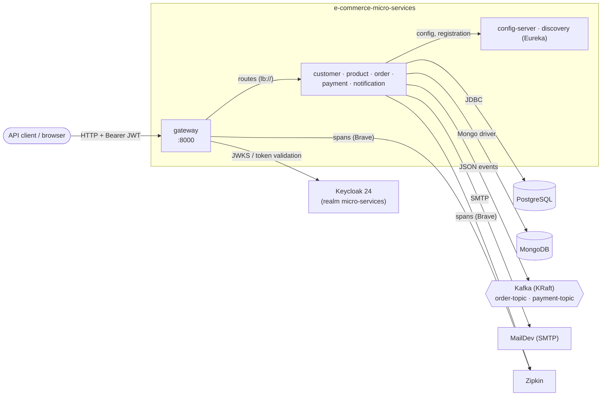
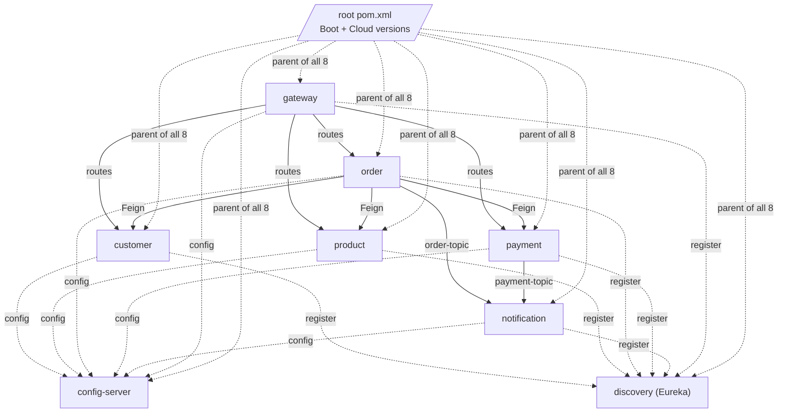
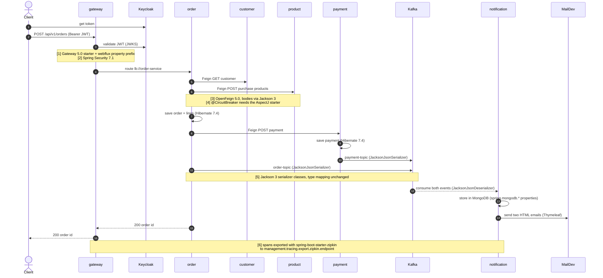
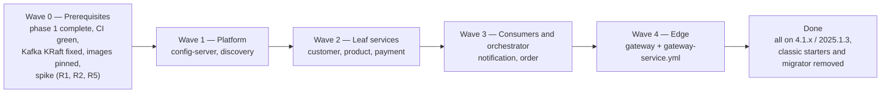

# e-commerce-micro-services: Migration to Spring Boot 4.1 (arc42, condensed)

| | |
|---|---|
| **Repository** | `github.com/CkanthG/e-commerce-micro-services` |
| **Describes** | Branch `develop` as of 16 Nov 2026 (Boot 3.5.15 / Spring Cloud 2025.0.3) |
| **Target** | Spring Boot **4.1.x** (latest patch, 4.1.2 at the time of writing) + Spring Cloud **2025.1.3** ("Oakwood"), Java 21 |
| **Related** | ADR-0001 (Boot 3.3.2 → 3.5, phase 1). This document is the architecture basis for phase 2, which ADR-0001 announces as ADR-0002 |
| **Last updated** | 16 Nov 2026 |
| **Status** | Proposed. |

The structure is a reduced arc42: introduction and goals, constraints, context, building blocks, runtime view, risks and technical debt. Each section describes the system **as it is**, then **what changes** with Boot 4.1.

---

## 1. Introduction and Goals

### 1.1 What the system does

A small e-commerce backend made of eight Spring services:

- **Customers** are stored and managed (customer service, MongoDB).
- **Products and categories** are maintained (product service, PostgreSQL, Flyway migrations).
- **Orders** are placed. The order service checks the customer, reserves products and requests a payment through OpenFeign. A Resilience4j circuit breaker protects these calls.
- **Payments** are recorded (payment service, PostgreSQL).
- **Notifications:** order and payment events go over Kafka to the notification service, which stores them (MongoDB) and sends HTML emails (Thymeleaf, SMTP → MailDev).
- **Platform:** a Config Server (native profile, files on the classpath), a Eureka discovery server and a Spring Cloud Gateway that validates Keycloak JWTs.
- **Tracing:** Micrometer + Brave → Zipkin.

### 1.2 Why migrate now

- Boot 3.5 and Spring Cloud 2025.0 have been past open-source support since 30 June 2026. No free fixes arrive for either line.
- Spring Cloud **2025.1.3** (20 Aug 2026) fixes, among others, **CVE-2026-47894, "Spring Cloud Config Server Native Environment Repository Exposure"**. This project's config-server runs exactly that mode (`spring.profiles.active: native`). The fix exists only on the 2025.1 line.
- Spring Boot **4.1** is the current stable line. It was released on 10 June 2026, and its open-source support runs until 31 July 2027 *(per a third-party support calendar; verify on spring.io)*. Spring Cloud 2025.1.2 added support for Boot 4.1.0.

### 1.3 Top 3 quality goals for the migration

| # | Quality goal | What it means for this migration | How we check it |
|---|---|---|---|
| 1 | **Supportability / security** | Every service runs on a Spring line that receives open-source fixes, including the Config Server CVE fix | All 8 services on Boot 4.1.x + Spring Cloud 2025.1.3; no Spring dependency on a 3.x line left (`mvn dependency:tree`) |
| 2 | **Functional equivalence (reliability)** | Users and other services notice nothing. Same REST APIs, same events, same emails, same tracing | Unchanged automated tests pass; end-to-end smoke test (§5.1) passes after every wave; event-compatibility test (R5) passes |
| 3 | **Maintainability** | The migration leaves no transitional crutches. Explicit, modular starters; no deprecated API in use; one version definition | No "classic" starters at the end; build without deprecation warnings; versions only in the root POM |

**Non-goals:** new features, replacing OpenFeign with HTTP interface clients, switching Brave to OpenTelemetry, or moving `TestRestTemplate` to `RestTestClient` beyond what 4.1 requires. These are listed as follow-ups (§6.3).

---

## 2. Constraints

### 2.1 Technical constraints (fixed decisions)

| Constraint | Value | Note |
|---|---|---|
| Spring Boot | **4.1.x**, latest patch | Spring Framework 7.0, Spring Security 7.1, Spring Data 2026.0, Spring Kafka 4.1, Hibernate 7.4, Jackson 3.1, Testcontainers 2.0, Flyway 12, MongoDB driver 5.8 (versions as shipped in 4.1.0) |
| Spring Cloud | **2025.1.3** | Cloud projects are on 5.0.x (Gateway 5.0.3, Config 5.0.5, OpenFeign 5.0.3). Resilience4j 2.3 via Spring Cloud Circuit Breaker |
| Java | **21** (unchanged) | Boot 4.1 supports Java 17 and newer. No reason to change the language level in the same step |
| Build | Maven, **one root parent POM** for versions (introduced in phase 1) | The Boot version is set once in `<parent>`, the Cloud version once in `<spring-cloud.version>` |
| Data stores | PostgreSQL (order, payment, product), MongoDB (customer, notification) | Schemas are not changed by this migration |
| Messaging | Kafka in **KRaft** mode (Confluent 8.x image, ZooKeeper removed) | Already required by the current `cp-kafka:latest`; must be finished in phase 1 (R9) |
| Identity | Keycloak 24, JWT validated by the gateway | Unchanged |
| Runtime | Docker Compose locally; Kubernetes manifests per service | — |

### 2.2 Organisational constraints

- **Entry criterion:** phase 1 (ADR-0001) is complete. The gateway is on the root parent and on 3.5.15, and the Hibernate 6.6 id fix and the Zipkin property fix are done (§6.2, R8). Starting phase 2 on a half-finished phase 1 mixes three Spring generations at once.
- One owner per service, one reviewer from another team per PR (as in ADR-0001).
- No CI pipeline exists yet. A GitHub Actions build of all modules is a prerequisite (wave 0).

### 2.3 Conventions for this migration

- **Two build steps per service:** compile against the **latest 4.0.x** first, fix every deprecation warning, then switch to **4.1.x**. Boot 4.1 removed everything deprecated in 4.0, so 4.0 is where the warnings are still visible. This happens on the branch only; 4.0 is never deployed.
- **No classic starters in the end state.** `spring-boot-starter-classic` / `-test-classic` may be used temporarily to get a service compiling, but must be gone before the PR is merged.
- **Properties are migrated, not bridged.** `spring-boot-properties-migrator` is used to *find* renamed properties, then the YAML in the config server is changed and the migrator removed again.

---

## 3. Context

### 3.1 System context



### 3.2 What changes at each interface

| Interface | Today (3.5) | With Boot 4.1 / Cloud 2025.1 | Action |
|---|---|---|---|
| Client → gateway (HTTP) | Spring Cloud Gateway 4.3 (WebFlux) | Gateway 5.0. The old artifact `spring-cloud-starter-gateway` **no longer exists**; only `spring-cloud-starter-gateway-server-webflux`. Properties only under `spring.cloud.gateway.server.webflux.*` | Rename the starter and the properties in `gateway-service.yml` |
| Gateway → Keycloak | Spring Security 6.5 resource server | Spring Security 7.1 resource server. The lambda DSL in `SecurityConfig` is already in the required style | Verify token validation with a real Keycloak token *(verify: stricter JWT validation in 7.1)* |
| Services → PostgreSQL | Hibernate 6.6, Flyway auto-configured from `flyway-core` | Hibernate 7.4. **Flyway only runs with `spring-boot-starter-flyway`**; `flyway-core` alone is no longer auto-configured | product: add the Flyway starter; compare schemas before and after (R6) |
| Services → MongoDB | `spring.data.mongodb.*` connection properties | Connection properties renamed to **`spring.mongodb.*`** (host, port, username, password, database, authentication-database) | Change customer and notification YAML; otherwise the services fall back to `localhost:27017` without credentials |
| Services ↔ Kafka | `JsonSerializer` / `JsonDeserializer` (Jackson 2), Spring Kafka 3.3 | Spring Kafka 4.1, kafka-clients 4.2. The Jackson 2 classes are deprecated in favour of **`JacksonJsonSerializer` / `JacksonJsonDeserializer`** (Jackson 3) | Change `key/value-(de)serializer` class names in order, payment and notification YAML. Keep the `spring.json.*` type mappings |
| order → customer/product/payment (Feign) | Spring Cloud OpenFeign 4.3 | OpenFeign 5.0, message conversion through Jackson 3 | Verify request/response bodies (amounts, dates) in the smoke test |
| Services → Zipkin | `micrometer-tracing-bridge-brave` + `zipkin-reporter-brave`, endpoint property `management.zipkin.tracing.endpoint` | **`spring-boot-starter-zipkin`**; endpoint under **`management.tracing.export.zipkin.*`** | Swap dependencies; set `management.tracing.export.zipkin.endpoint` |
| Services → config-server / Eureka | Config 4.3, Netflix 4.3 | Config 5.0.5, Netflix 5.0.x | Verify that 3.5 clients still work against the 4.1 server during the mixed period |

---

## 4. Building Block View

### 4.1 Level 1: services and dependencies



- **Synchronous dependencies:** only from the gateway (routing) and from order (Feign to customer, product, payment).
- **Asynchronous dependencies:** order and payment publish to Kafka; notification consumes. The event classes are **copied** into each service (`OrderConfirmation`, `PaymentConfirmation` / `PaymentNotificationRequest`), connected only by `spring.json.type.mapping` names.
- **Shared configuration:** every service reads its YAML from the config server (`services/config-server/src/main/resources/configurations/*.yml`). Most property renames in §4.2 are changes to **this one module**, but they affect every team.
- **Shared versions:** the root POM. Spring Boot is switched for all inheriting services at once.

### 4.2 Impact per building block

Dependencies and code were read from `develop`. "S/M/L" is an effort estimate per service *(to be confirmed by the owners)*.

| Building block | Main-code dependencies to change | Config to change (in config-server unless noted) | Code / test changes | Effort |
|---|---|---|---|---|
| **root pom.xml** | Parent `3.5.15` → `4.1.x`; `spring-cloud.version` → `2025.1.3` | — | — | S |
| **config-server** | none (`spring-cloud-config-server` keeps its name) | own `application.yml`: check with properties-migrator | Context-load test only. Pick up the CVE fix by upgrading | S |
| **discovery** | none | — | Check that Eureka clients on 3.5 still register during the mixed period | S |
| **gateway** | `spring-cloud-starter-gateway` → **`spring-cloud-starter-gateway-server-webflux`**; Brave+Zipkin → `spring-boot-starter-zipkin`; `spring-boot-starter-oauth2-resource-server` → check the security-namespaced starter name *(verify)* | `gateway-service.yml`: `spring.cloud.gateway.*` → `spring.cloud.gateway.server.webflux.*`; decide on `trusted-proxies` | Fix the stray `(` in `pathMatchers("(/eureka/**")` while touching the file | M |
| **customer** | `spring-boot-starter-web` → **`spring-boot-starter-webmvc`**; Zipkin starter; remove `junit:junit`; Testcontainers `mongodb` → **`testcontainers-mongodb`**, `junit-jupiter` → `testcontainers-junit-jupiter`; remove the explicit `testcontainers` 1.20.0 pin and `commons-compress` | `customer-service.yml`: `spring.data.mongodb.*` → **`spring.mongodb.*`** | Test: `com.fasterxml.jackson` `ObjectMapper` → Jackson 3 (`tools.jackson.databind`). `TestRestTemplate` needs **`@AutoConfigureTestRestTemplate`** + the `spring-boot-resttestclient` module. `MongoDBContainer` import moves to the 2.x package. Remove leftover `@RunWith` | M |
| **product** | `-web` → `-webmvc`; `flyway-core` → **`spring-boot-starter-flyway`** (keep `flyway-database-postgresql`); Zipkin starter; Testcontainers `postgresql` → `testcontainers-postgresql`; remove `junit:junit`, `testcontainers` pin, `commons-compress` | — | `TestRestTemplate` as above; `PostgreSQLContainer` import moves to the 2.x package; Flyway 12 must still validate V1/V2 | M |
| **order** | `-web` → `-webmvc`; **`spring-boot-starter-aop` → `spring-boot-starter-aspectj`**; Resilience4j (R2); OpenFeign (name unchanged); `spring-kafka` (name unchanged); Zipkin starter; Testcontainers `kafka`, `postgresql` → `testcontainers-kafka`, `testcontainers-postgresql` | `order-service.yml`: `JsonSerializer` → `JacksonJsonSerializer`; check `resilience4j.*` keys still bind | `KafkaContainer` (old `org.testcontainers.containers` class, image `cp-kafka:latest`) → a 2.x Kafka container with a **pinned** image (R7). `TestRestTemplate` as above | L |
| **payment** | as order: webmvc, aspectj, Resilience4j, Zipkin, Testcontainers renames | `payment-service.yml`: `JsonSerializer` → `JacksonJsonSerializer` | as order (KafkaContainer, TestRestTemplate) | M–L |
| **notification** | Zipkin starter; `spring-kafka` unchanged; Mongo, Mail, Thymeleaf starters keep their names | `notification-service.yml`: `JsonDeserializer` → `JacksonJsonDeserializer`; `spring.data.mongodb.*` → `spring.mongodb.*`; restrict `spring.json.trusted.packages` from `'*'` to `com.sree.ecommerce.kafka` | Test is context-load only; add an event-consumption test (R5) | M |

**Test dependencies for all services:** Boot 4 splits test support per technology. Each main starter gets its matching test starter (`spring-boot-starter-webmvc-test`, `-data-jpa-test`, `-data-mongodb-test`, `-kafka-test` …) next to or instead of the plain `spring-boot-starter-test` *(exact list: run the OpenRewrite recipe or check the migration guide's starter table)*.

---

## 5. Runtime View

### 5.1 Scenario A: placing an order (what changes along the way)

This is the end-to-end flow that every wave's smoke test runs. The numbered notes mark the points where Boot 4.1 changes the technology underneath.



**Smoke test (run after each wave):**
1. Token from Keycloak; all calls through the gateway.
2. Create a customer, a category and a product; place an order.
3. Expected: order and payment rows in PostgreSQL; two documents in MongoDB; two emails in MailDev.
4. Zipkin shows **one** trace from gateway → order → customer/product/payment, and the Kafka hop where instrumented.
5. Eureka shows all services; no `ERROR` and no deprecation warnings in the logs of the upgraded services.

### 5.2 Scenario B: rollout and the mixed-version period



| Wave | Why this order | Exit criterion |
|---|---|---|
| 0 | Nothing can be verified without CI and a working Kafka. Unknowns (Resilience4j, event JSON) are cheaper to settle in a spike than in a wave | Spike branch builds all services on 4.1.x; R1, R2, R5 answered |
| 1 | config-server carries the CVE fix and is the smallest change. Clients on 3.5 must keep working against it | 3.5 services still load config and register |
| 2 | customer, product, payment have no synchronous outbound calls | Each passes its tests and the smoke test through the old gateway |
| 3 | notification consumes events from order and payment; order calls the leaf services | Events from a 4.1 producer are consumed correctly, and vice versa (R5) |
| 4 | Gateway has the largest blast radius and its config change must ship **together** with the gateway upgrade | All routes work with a valid token; no deprecated gateway names left |

**The root-POM wrinkle.** With one root parent, the Boot version can only be switched for everyone at once, so waves aren't possible by version alone. Options:

- **(a) Recommended:** each wave's services temporarily point their `<parent>` at a second root POM (`pom-boot4.xml` or a `boot4` module parent) until the last wave, then the main root switches and the temporary parent is deleted.
- **(b)** Do all code and config changes per wave on long-lived branches, and switch the root version once at the end. Simpler, but one big integration step.

Owners decide in wave 0 *(open question)*.

**Shared YAML during the mixed period.** A renamed property (e.g. `spring.mongodb.*`) must only be switched when the service reading it is upgraded. Keep old and new keys side by side, or switch in the same PR as the service. Never switch the shared config first.

---

## 6. Risks and Technical Debt

### 6.1 Migration risks

| ID | Risk | Likelihood | Impact | Mitigation |
|---|---|---|---|---|
| R1 | **Unknowns surface late.** 42+ compile-breaking changes are reported for Boot 4.0 in general *(per a third-party guide)*, plus Spring Cloud 5.0 removals | High | Waves stall | Wave 0 spike: one branch, all services bumped with the OpenRewrite recipe `org.openrewrite.java.spring.boot4.UpgradeSpringBoot_4_0`, compiled and tested. The result is used as a checklist, not merged as is |
| R2 | **Resilience4j annotations on Boot 4.** order and payment use `@CircuitBreaker` via `resilience4j-spring-boot3` + the AOP starter. I could not confirm that this artifact works on Boot 4 *(verify)*; Spring Cloud 2025.1 ships Resilience4j 2.3 through its own Circuit Breaker starter | Medium | Circuit breaker silently inactive, or start-up failure | Spike: check that the aspect is applied (a test that triggers the fallback). Fallbacks: `spring-cloud-starter-circuitbreaker-resilience4j` with `CircuitBreakerFactory`, or a Boot-4 Resilience4j starter if one is released |
| R3 | **Silent misconfiguration from renamed properties** (Mongo, Zipkin, gateway prefix). Old keys are ignored without an error | High | Services connect to defaults (localhost, no auth), traces go nowhere, routes vanish | `spring-boot-properties-migrator` on every service start in the waves; smoke test checks data actually lands in the right databases |
| R4 | **Flyway stops running** in product because `flyway-core` is no longer auto-configured | High (without action) | Schema migrations skipped; later queries fail on missing tables or columns | Add `spring-boot-starter-flyway`; test asserts that `flyway_schema_history` contains V1 and V2 |
| R5 | **Event and Feign JSON incompatibility between Jackson 2 and Jackson 3** during the mixed period (e.g. `BigDecimal` amounts, date formats, type headers) | Medium | Notifications not sent, or wrong values in emails | Contract test in the spike: serialize each event with the 3.5 producer config, deserialize with the 4.1 consumer config, and the other way round |
| R6 | **Hibernate 7.4 with `ddl-auto: update`** (order, payment) issues different DDL | Low–medium | Unexpected column changes | DB snapshot before each wave; compare `pg_dump --schema-only` before and after |
| R7 | **Kafka integration tests use `cp-kafka:latest`** with the old Testcontainers `KafkaContainer`. Since Confluent 8 is KRaft-only, these tests may **already** fail today *(verify)*, and the class moves in Testcontainers 2 | High | Red tests that hide real regressions | Switch to a Testcontainers 2 Kafka container with a pinned image as the first change in order and payment |
| R8 | **Phase 1 not finished:** gateway on 3.3.2 with its own parent; the Hibernate 6.6 id fix (ADR-0001 I-3) and the Zipkin property fix (I-5) not done | Certain (today) | Three Spring generations at once; known order/payment/product create bug carried along | Entry criterion (§2.2): close phase 1 first |
| R9 | **Kafka compose config inconsistent:** KRaft variables are set, but `KAFKA_ZOOKEEPER_CONNECT` and the zookeeper dependency are still there; `KAFKA_LISTENER_SECURITY_PROTOCOL_MAP` has no `CONTROLLER` entry; listeners bind to `localhost` inside the container | High | Broker doesn't start or isn't reachable from the host | Fix in wave 0: complete KRaft block, listeners on `0.0.0.0`, pinned 8.x image, ZooKeeper removed |
| R10 | **Boot 4.2 lands during the migration** (expected around 19 Nov 2026 *(third-party date, verify)*) | Certain | Pressure to retarget | Stay on 4.1: Spring Cloud for 4.2 (2026.0 "Paddington") was still at milestone 1 in September. 4.1 → 4.2 is a later minor step (§6.3) |
| R11 | **Mixed versions last too long** | Medium | Teams build on different baselines; shared YAML has to carry both key styles | Fixed schedule per wave; initiative lead tracks the waves |

### 6.2 Technical debt carried into the migration (fix in phase 1 or during the wave)

| Debt | Where | Why it matters for 4.1 |
|---|---|---|
| Client-supplied `id` copied into `@GeneratedValue` entities | order, payment, product mappers | Already breaks on Hibernate 6.6+ (`OptimisticLockException`); still breaks on 7.4 |
| `spring.zipkin.*` (Sleuth-era) properties | 6 `application.yml` files | Ignored since Boot 3; Boot 4 renames the real property again. Fix once, directly to `management.tracing.export.zipkin.endpoint` |
| JUnit 4 dependency and `@RunWith` leftovers | customer, product, 6 controller tests | JUnit 4 support is deprecated in Spring Framework 7; Testcontainers 2 no longer brings JUnit 4 transitively *(verify)* |
| Explicit Testcontainers 1.20.0 pin and `commons-compress` | customer, product | Conflicts with the Testcontainers 2 version managed by Boot 4.1 |
| `spring.json.trusted.packages: '*'` | notification | Unnecessarily wide deserialization trust |
| `@EnableAsync` imported but not applied | notification | `@Async` email sending runs on the Kafka listener thread |
| `pathMatchers("(/eureka/**")` typo | gateway `SecurityConfig` | Intended permit rule never matches |
| `:latest` images (postgres, mongo, kafka, zipkin, maildev, pgadmin, mongo-express) | docker-compose | Unplanned major upgrades during the migration (the Kafka/ZooKeeper failure was one) |
| No CI | repository | No automatic signal that a wave broke something |

### 6.3 Follow-ups after the migration (not part of this plan)

- **Boot 4.2 + Spring Cloud 2026.0** once 2026.0 is GA. Expected small: 4.2 deprecates `TestRestTemplate` and `RestTemplate` for removal *(as of 4.2 milestones)*, so moving tests to `RestTestClient` belongs there.
- **OpenFeign → Spring HTTP interface clients** (`@HttpExchange`), optionally with Spring Cloud's load balancing.
- **Brave → OpenTelemetry** (`spring-boot-starter-opentelemetry`), if Zipkin is to be replaced by an OTLP backend.
- **Shared event-contract module** instead of copied event classes.

### 6.4 Summary

Boot 4.1 isn't a "bump the version" upgrade for this project. Most of the work is renaming dependencies and properties: modular starters, gateway, Mongo, Zipkin, Flyway, Kafka serializers, Testcontainers 2. Many of these renames fail **silently** rather than at compile time, so the smoke test and the properties-migrator report matter more than a green compile. The real unknowns are Resilience4j on Boot 4 (R2) and JSON compatibility during the mixed period (R5). Both belong in a short spike before wave 1. Finishing phase 1 is the precondition (R8).

---

## Appendix A: Per-service PR checklist

```markdown
- [ ] Inherits Boot 4.1.x / Spring Cloud 2025.1.3 (no own versions)
- [ ] Compiled against latest 4.0.x first; all deprecation warnings fixed
- [ ] Renamed starters applied (webmvc, aspectj, gateway-server-webflux, flyway, zipkin)
- [ ] Matching test starters added; no classic starters left
- [ ] Testcontainers 2 artifacts and imports; pinned images
- [ ] Properties-migrator report clean, then migrator removed
- [ ] Shared YAML keys changed only for this service (old keys kept if others still read them)
- [ ] Tests green in CI; smoke test (§5.1) passed with the current service mix
- [ ] Reviewed by someone from another team
```

## Appendix B: Sources

- Spring Boot 4.0 Migration Guide (official): https://github.com/spring-projects/spring-boot/wiki/Spring-Boot-4.0-Migration-Guide
- Spring Boot 4.1.0 release (10 Jun 2026): https://spring.io/blog/2026/06/10/spring-boot-4/ and dependency upgrades: https://github.com/spring-projects/spring-boot/releases/tag/v4.1.0
- Modularizing Spring Boot (starters, test starters, classic starters): https://spring.io/blog/2025/10/28/modularizing-spring-boot
- Spring Cloud 2025.1.0 (Oakwood) release notes: https://spring.io/blog/2025/11/25/spring-cloud-2025-1-0-aka-oakwood-has-been-released/
- Spring Cloud 2025.1.2 (Boot 4.1.0 compatibility): https://spring.io/blog/2026/06/11/spring-cloud-2025-1-2-aka-oakwood-has-been-released/
- Spring Cloud 2025.1.3 (CVE fixes incl. Config Server native repository): https://spring.io/blog/2026/08/20/spring-cloud-2025-1-3-has-been-released/
- Spring Cloud 2026.0.0-M1 (based on Boot 4.2.0-M2): https://spring.io/blog/2026/09/24/spring-cloud-2026-0-0-M1-has-been-released/
- Boot 4 tracing docs (Zipkin starter, `management.tracing.export.zipkin.*`): https://docs.spring.io/spring-boot/4.0/reference/actuator/tracing.html
- Boot 4 test utilities (`@AutoConfigureTestRestTemplate`): https://docs.spring.io/spring-boot/4.0/reference/testing/test-utilities.html
- OpenRewrite: Spring Boot 4.0 property migrations (Mongo keys): https://docs.openrewrite.org/recipes/java/spring/boot4/springbootproperties_4_0
- OpenRewrite: starter renames (AOP → AspectJ, web → webmvc): https://docs.openrewrite.org/recipes/java/spring/boot4/renamedeprecatedstartersmanagedversions
- OpenRewrite: Testcontainers 2 dependency renames: https://docs.openrewrite.org/recipes/java/testing/testcontainers/testcontainers2dependencies
- Confluent: ZooKeeper removed as of Confluent Platform 8.0: https://docs.confluent.io/platform/current/installation/docker/config-reference.html